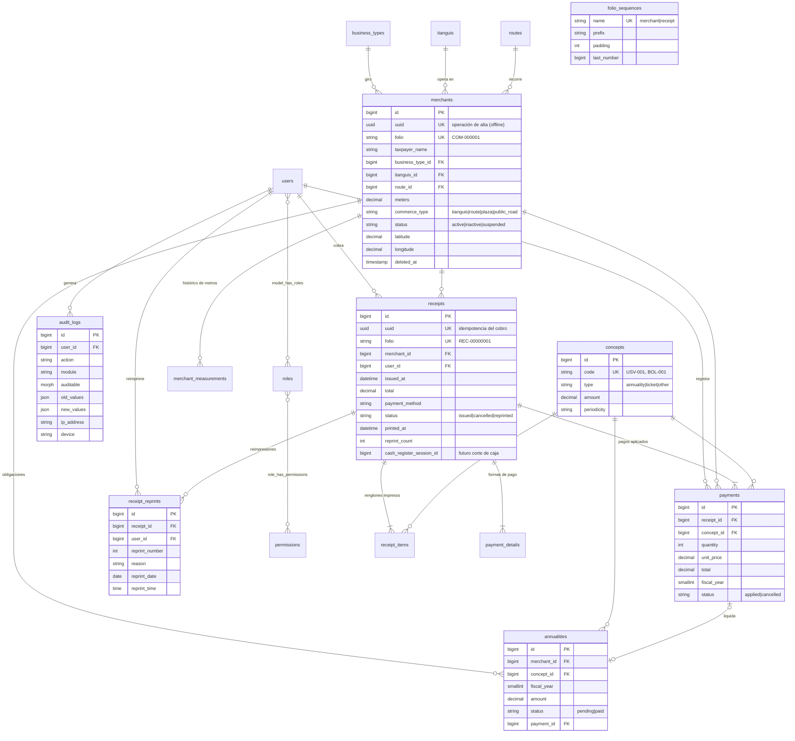

# Arquitectura

## Componentes

```
┌──────────────────────────────┐        ┌──────────────────────────────┐
│ Panel web (Inertia + React)  │        │ App Android (Kotlin/Compose) │
│ sesión + CSRF (Fortify)      │        │ Room · cola de sincronización │
└──────────────┬───────────────┘        └──────────────┬───────────────┘
               │ rutas web                              │ /api/v1 (Bearer Sanctum)
┌──────────────▼────────────────────────────────────────▼───────────────┐
│ Controladores delgados → Form Requests → Policies                      │
│ Servicios de dominio (app/Services):                                   │
│   MerchantService · PaymentService · ReceiptService · FolioGenerator   │
│   AnnualityService · AccountStatementService · TicketPresenter         │
│   DashboardService · AuditLogger · QrCodeService                       │
│ Reportes (app/Reports) → ReportExporter (Excel/CSV/PDF)                │
└──────────────────────────────────┬────────────────────────────────────┘
                                   │ Eloquent
                              ┌────▼────┐
                              │ MySQL 8 │
                              └─────────┘
```

- **Toda la lógica de negocio vive en servicios**; web y API los comparten, de modo que un cobro hecho desde Android sigue exactamente las mismas reglas que uno hecho en el panel.
- **Autorización**: roles y permisos con `spatie/laravel-permission` (enum `App\Enums\Permission`), policies para `Merchant`, `Receipt` y `User`; el administrador pasa todas las verificaciones con `Gate::before`.
- **Auditoría**: el trait `Auditable` registra altas/cambios/bajas de catálogos, comerciantes y usuarios; los servicios registran explícitamente cobros, impresiones, reimpresiones, cancelaciones, consultas y exportaciones.

## Diagrama entidad-relación



## Reglas de negocio

| Regla                                                                       | Dónde                                                                                        |
| --------------------------------------------------------------------------- | -------------------------------------------------------------------------------------------- |
| Boleto: `total = cantidad × $40.00` (precio vigente del concepto `BOL-001`) | `PaymentService::buildLines()`                                                               |
| Anualidad: `$155.00` por ejercicio fiscal (concepto `USV-001`)              | `PaymentService::lockAnnuality()`                                                            |
| Una sola anualidad pagada por comerciante, concepto y ejercicio             | índice único `annualities(merchant_id, concept_id, fiscal_year)` + bloqueo `FOR UPDATE`      |
| Folios consecutivos sin duplicados con cobros simultáneos                   | `FolioGenerator` (renglón de `folio_sequences` bloqueado dentro de la transacción del cobro) |
| Folios cancelados no se reutilizan                                          | la secuencia solo avanza; la cancelación no la toca                                          |
| Mismo UUID ⇒ mismo recibo (sin cobro doble en reintentos)                   | índice único `receipts.uuid` + `PaymentService::charge()`                                    |
| Sólo comerciantes activos pueden recibir cobros                             | `PaymentService::createReceipt()`                                                            |
| Importes con aritmética decimal exacta (`bcmath`)                           | `PaymentService::lineTotal()`                                                                |
| El recibo conserva el precio cobrado aunque cambie el catálogo              | `receipt_items` / `payments.unit_price`                                                      |
| Impresión original una sola vez; después sólo reimpresión con motivo        | `ReceiptService::markPrinted()` / `reprint()`                                                |
| Reimpresión no genera cobro; queda numerada e inmutable                     | `ReceiptReprint` (lanza excepción al modificar/eliminar)                                     |
| Cancelación: no borra, marca pagos como cancelados y reabre anualidades     | `ReceiptService::cancel()`                                                                   |
| Recibos y auditoría nunca se eliminan                                       | `Receipt::deleting`, `AuditLog::updating/deleting`                                           |
| Cambio de metros conserva histórico con motivo                              | `MerchantService::update()` → `merchant_measurements`                                        |
| El QR del comerciante contiene sólo su folio                                | `Merchant::qrPayload()`                                                                      |
| El QR del ticket apunta a una verificación pública sin datos personales     | `/verificar/{uuid}`                                                                          |

## Preparado para crecer

- **Control de caja**: `receipts.cash_register_session_id` (nullable, indexado) y `payment_details` con el desglose por forma de pago (efectivo/transferencia/tarjeta). Una tabla `cash_register_sessions` podrá enlazarse sin tocar pagos ni recibos.
- **Nuevos conceptos** (licencias, multas, permisos): se dan de alta en `concepts` con `type = other`; el cobro, recibo, reimpresión, reportes y auditoría funcionan sin cambios.
- **Nuevos módulos** (inspecciones, comercio establecido): nuevas tablas relacionadas con `merchants`; los permisos se agregan al enum `Permission` y al seeder de roles.
- **Nuevos reportes**: una clase que extienda `App\Reports\Report` y su registro en `ReportFactory::REPORTS` obtiene vista web, API y exportación Excel/CSV/PDF.
